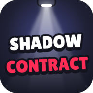

<p align="center">
  
</p>

# Shadow Contract

Jogo de ação furtiva com visão de cima, feito para navegador e celular. Atravesse salas, evite os cones de visão e o barulho que chama os inimigos, elimine os alvos e chegue às lojas para escolher equipamento antes do próximo contrato.

## O jogo

- **Furtividade:** inimigos patrulham, investigam sons e perseguem o personagem quando entram em alerta. Ficar parado por muito tempo também atrai perseguidores.
- **Combate:** aproxime-se por trás para um golpe furtivo, use espada ou armas de fogo e desvie dos ataques com o salto de esquiva.
- **Progressão:** as salas trazem dinheiro, caixas destrutíveis e itens de cura, escudo ou salto. A cada contrato há uma loja com preços variáveis.
- **Personalização:** ajuste a aparência do personagem e a cor do sangue na tela inicial.
- **Análise da partida:** ao morrer, consulte acertos, erros, dano, vida recuperada e o registro de eventos. O recorde e algumas preferências ficam salvos no navegador.
- **Instalação:** o jogo pode ser instalado como PWA em dispositivos compatíveis e mantém os arquivos necessários em cache para jogar offline depois do primeiro carregamento.

## IA e dificuldade dos inimigos

Os inimigos combinam visão, audição e investigação. A visão depende do cone, da distância e de uma linha de visão sem paredes. Quando percebem um som, já mudam a rota para investigar o último lugar em que ouviram o personagem; sons novos atualizam esse destino. Se o personagem continuar fazendo barulho perto deles, a escuta avança até o alerta e eles passam a persegui-lo.

O indicador de audição mostra esse avanço: **branco** quando notam o som, **amarelo** durante a investigação e **vermelho** quando entram em perseguição. A intensidade depende da distância e do nível de inteligência do inimigo. Paredes bloqueiam a visão, mas não o som. O personagem agachado anda mais devagar e faz metade do barulho; pela audição, isso pode levar à investigação, mas não ao alerta vermelho. Tiros sem silenciador chamam inimigos próximos imediatamente.

A dificuldade cresce em ritmos diferentes:

- A detecção visual fica mais rápida e o alcance de visão aumenta conforme o personagem avança pelas salas.
- Surge um inimigo adicional a cada três salas, quando o modelo da sala oferece espaço para ele.
- A partir da sala 2, inimigos em alerta podem usar dash. Ninjas do nível de inteligência 10 em diante também arremessam shurikens.
- Cada grupo de cinco salas forma um nível de inteligência. Os multiplicadores de **escuta**, **limiar para entrar em alerta**, **perseguição** e **dash** crescem gradualmente: a escuta pode ganhar até 70% de alcance e velocidade, a perseguição até 55%, e o dash até 50%. O limiar de alerta diminui até 25%, então os inimigos precisam ouvir menos para perseguir.
- A partir do nível 6, cada perfil recebe variações aleatórias de até 10% nesses multiplicadores. O perfil é sorteado uma vez e depois reutilizado.

## Persistência

O Zustand salva preferências e dados permanentes em JSON no `localStorage`, na chave `shadow-contract`:

- **Recorde**, aparência do personagem e cor do sangue.
- **Inteligência por nível**, com os multiplicadores de escuta, limiar de alerta, perseguição e dash. O perfil é criado quando aquele nível aparece pela primeira vez e continua valendo nas próximas partidas.
- **Variação de dano do personagem**, sorteada na primeira partida e reutilizada. Cada ataque continua sorteando dano dentro dessa faixa.

Exemplo simplificado do perfil salvo:

```json
{
  "state": {
    "intelligence": {
      "6": {
        "hearing": 1.42,
        "hearingThreshold": 0.71,
        "pursuit": 1.38,
        "dash": 1.31
      }
    }
  }
}
```

Os dados são validados ao carregar; perfis de inteligência fora das faixas aceitas são descartados. Essa persistência conserva os multiplicadores sorteados por nível, não um aprendizado baseado no resultado das partidas. A posição, vida, munição, chance variável de erro da facada e eventos da partida pertencem à run atual e não são restaurados após recarregar a página.

## Controles

| Ação                                   | Teclado         |
| -------------------------------------- | --------------- |
| Mover                                  | `WASD` ou setas |
| Salto de esquiva                       | `Espaço`        |
| Agachar                                | `C` ou `Ctrl`   |
| Interagir com caixa ou atacar de perto | `F`             |
| Abrir ou fechar o baú da loja          | `B`             |
| Trocar de arma                         | `Q`             |
| Pausar                                 | `P`             |
| Iniciar a partida                      | `Enter`         |

No celular, arraste o joystick na parte inferior para mover. Os botões à direita servem para saltar e agachar. Toque no ícone de interação sobre o alvo para quebrar caixas, atacar de perto ou abrir o baú; as armas também podem ser escolhidas pelo HUD.

## Tecnologias

| Tecnologia               | Uso no projeto                                  |
| ------------------------ | ----------------------------------------------- |
| React e TypeScript       | Interface e código tipado                       |
| Three.js                 | Cenário, personagens e efeitos em 3D            |
| Vite                     | Servidor de desenvolvimento e build             |
| Tailwind CSS             | Estilos da interface                            |
| Zustand                  | Estado do jogo e preferências no `localStorage` |
| Radix UI e Lucide        | Componentes de interface e ícones               |
| Vite PWA e Workbox       | Instalação e cache offline                      |
| Vitest e Testing Library | Testes da simulação e da interface              |

## Executar localmente

É necessário ter Node.js e pnpm instalados. Na raiz do projeto:

```bash
pnpm install
pnpm dev
```


Abra no navegador o endereço exibido pelo Vite. Para conferir o projeto:

```bash
pnpm test
pnpm typecheck
pnpm lint
pnpm build
```

`pnpm preview` serve a versão gerada pelo build.

## Estrutura

- `src/app/modules`: regras de mundo, salas, inimigos, combate e loja.
- `src/app/engine`: renderização deste jogo com Three.js; loop, input e renderer base vêm do `three-hex-engine`.
- `src/resources`: telas React, controles e interface.
- `src/shared`: estilos, cores e textos.
- `three-hex-engine` (dependência npm, https://github.com/lucashhoffmann/three-hex-engine): o que serve a qualquer jogo, compartilhado com os outros jogos.
- `docs`: contratos entre módulos, organização e estratégia de testes.
